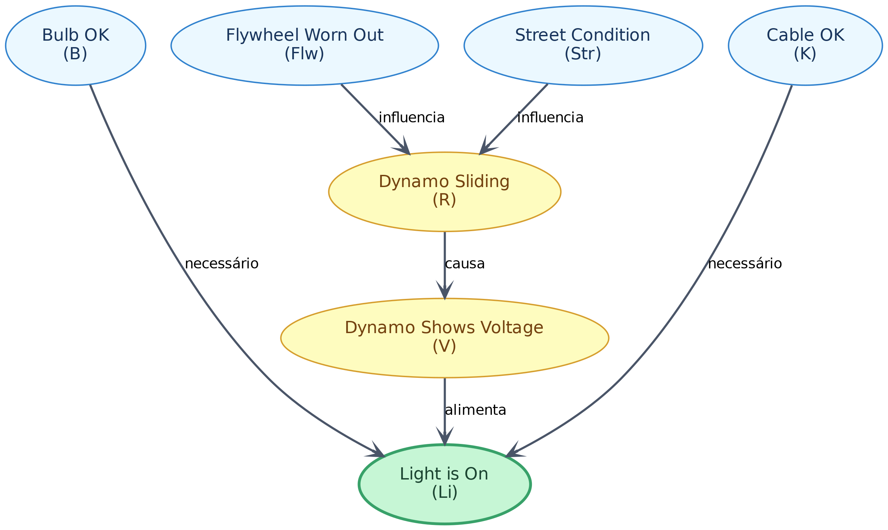

# Resolução - Questão 1: Rede Bayesiana do Farol de Bicicleta

Este repositório contém a resolução completa da **1ª Questão** sobre Raciocínio Probabilístico e Redes Bayesianas aplicada ao sistema de farol de bicicleta alimentado por dínamo.

---

## 📐 (a) Estrutura da Rede Bayesiana (DAG)

A imagem abaixo representa o Grafo Acíclico Dirigido (DAG) da Rede Bayesiana de Causalidade:

### Variáveis da Rede
* **$Str$** (*Street condition*): Condição da pista $\in \{\text{dry}, \text{wet}, \text{snow-covered}\}$.
* **$Flw$** (*Dynamo flywheel worn out*): Volante do dínamo desgastado $\in \{t, f\}$.
* **$R$** (*Dynamo sliding*): Dínamo deslizando $\in \{t, f\}$.
* **$V$** (*Dynamo shows voltage*): Presença de voltagem no dínamo $\in \{t, f\}$.
* **$B$** (*Light bulb ok*): Lâmpada intacta $\in \{t, f\}$.
* **$K$** (*Cable ok*): Cabo do circuito intacto $\in \{t, f\}$.
* **$Li$** (*Light is on*): Farol aceso $\in \{t, f\}$.

---

## 📊 (b) e (c) Tabelas de Probabilidade Condicional (CPTs)

### 1. Prioris dos Nós Raiz
* **$P(Str)$**:
  * $P(Str = \text{dry}) = 0.70$
  * $P(Str = \text{wet}) = 0.20$
  * $P(Str = \text{snow-covered}) = 0.10$
* **$P(Flw = t) = 0.05$** $\implies P(Flw = f) = 0.95$
* **$P(B = t) = 0.90$** $\implies P(B = f) = 0.10$
* **$P(K = t) = 0.95$** $\implies P(K = f) = 0.05$

### 2. CPT para $R$ dado $\{Str, Flw\}$ — $P(R = t \mid Str, Flw)$
| $Str$ | $Flw$ | $P(R = t)$ |
| :---: | :---: | :---: |
| $\text{dry}$ | $f$ | 0.01 |
| $\text{dry}$ | $t$ | 0.20 |
| $\text{wet}$ | $f$ | 0.10 |
| $\text{wet}$ | $t$ | 0.50 |
| $\text{snow-covered}$ | $f$ | 0.80 |
| $\text{snow-covered}$ | $t$ | 0.98 |

### 3. CPT para $V$ dado $R$ — $P(V = t \mid R)$
| $R$ | $P(V = t)$ |
| :---: | :---: |
| $f$ | 0.99 |
| $t$ | 0.10 |

### 4. CPT para $Li$ dado $\{V, B, K\}$ — $P(Li = t \mid V, B, K)$
| $V$ | $B$ | $K$ | $P(Li = t)$ |
| :---: | :---: | :---: | :---: |
| $t$ | $t$ | $t$ | **0.99** |
| $t$ | $t$ | $f$ | **0.01** |
| $t$ | $f$ | $t$ | **0.01** |
| $t$ | $f$ | $f$ | **0.001** |
| $f$ | $t$ | $t$ | **0.30** |
| $f$ | $t$ | $f$ | **0.005** |
| $f$ | $f$ | $t$ | **0.005** |
| $f$ | $f$ | $f$ | **0.00** |

---

## 🔍 (d) Ausência da Aresta Direta $(Str, Li)$

**Justificativa por D-separação e Independência Condicional:**
1. O efeito da condição da pista ($Str$) sobre o acendimento do farol ($Li$) é totalmente mediado pelo deslizamento mecânico do dínamo ($R$) e pela voltagem elétrica gerada ($V$).
2. Pelo enunciado, vale $P(Li \mid V, R) = P(Li \mid V)$.
3. No grafo, o nó $V$ **d-separa** $Str$ de $Li$. Portanto, $Str$ e $Li$ são condicionalmente independentes dado $V$ (junto aos pais diretos $B$ e $K$):
   $$P(Li \mid V, B, K, Str) = P(Li \mid V, B, K)$$
4. Uma aresta direta $Str \to Li$ representaria uma influência causal direta não mediada, o que violaria as premissas físicas do modelo.

---

## 🧮 (e) Cálculo de $P(V \mid Str = \text{snow-covered})$

### Passo 1: Marginalização sobre $Flw$
$$P(R = t \mid \text{snow-covered}) = \sum_{f \in \{t, f\}} P(R = t \mid \text{snow-covered}, Flw = f) \cdot P(Flw = f)$$
$$P(R = t \mid \text{snow-covered}) = (0.98 \times 0.05) + (0.80 \times 0.95) = 0.049 + 0.76 = \mathbf{0.809}$$
$$P(R = f \mid \text{snow-covered}) = 1 - 0.809 = \mathbf{0.191}$$

### Passo 2: Probabilidade Total para Voltagem $V$
$$P(V = t \mid \text{snow-covered}) = \sum_{r \in \{t, f\}} P(V = t \mid R = r) \cdot P(R = r \mid \text{snow-covered})$$
$$P(V = t \mid \text{snow-covered}) = (0.10 \times 0.809) + (0.99 \times 0.191) = 0.0809 + 0.18909 = \mathbf{0.26999} \approx \mathbf{27\%}$$

### Resultado Final:
* $P(V = t \mid Str = \text{snow-covered}) \approx \mathbf{27.0\%}$
* $P(V = f \mid Str = \text{snow-covered}) \approx \mathbf{73.0\%}$
